# Rengera — Autonomous Coding Agent & Multi-Region Deployment Infrastructure

> **Unified control plane for deterministic code synthesis, ephemeral microVM verification, and zero-downtime global deployments.**

Rengera is a distributed software engineering platform that combines an **AST-aware autonomous coding agent** with a **declarative multi-region deployment fabric**. It plans repository-wide refactors, synthesizes verified patches inside isolated Firecracker microVMs, and promotes immutable OCI artifacts across edge PoPs with automated canary rollback.

---

## Core Architecture

```mermaid
flowchart LR
    U["Developer / CI Trigger"] --> CP["Control Plane (Scheduler & Policy)"]
    CP --> AG["Autonomous Coding Agent"]
    AG --> AST["Semantic AST Graph & Patch Synthesizer"]
    AST --> VM["Firecracker MicroVM Sandbox"]
    VM -->|Verified Artifacts| REG["Content-Addressed OCI Registry"]
    REG --> DEP["Deployment Infra Mesh"]
    DEP --> EDGE["Global Edge PoPs & Canary Router"]
    EDGE --> TEL["eBPF Telemetry & Auto-Rollback"]
    TEL --> CP
```



### 1. Autonomous Coding Agent (`agent-runtime`)
- **Repository Graph Indexing**: Builds incremental symbol, call-graph, and type-constraint indices across polyglot monorepos (Rust, Go, TypeScript, Python).
- **Speculative Patch Synthesis**: Generates candidate diffs in parallel, scores them against static invariants, and prunes non-compiling branches before touching the host workspace.
- **Ephemeral MicroVM Execution**: Every agent tool call, test suite, and build runs inside a snapshot-backed Firecracker microVM with sub-150ms cold start and strict egress policies.
- **Deterministic Replay**: Every reasoning step, AST edit, and sandbox stdout/stderr stream is content-addressed for bit-for-bit auditability.

### 2. Deployment Infrastructure (`deploy-mesh`)
- **Declarative Topology Engine**: Compiles service graphs into region-pinned Kubernetes operators, edge workers, and bare-metal Nomad allocations.
- **Progressive Canary & Traffic Shifting**: Automated 1% -> 10% -> 50% -> 100% rollouts gated by p99 latency, error-budget burn rate, and eBPF syscall anomaly detection.
- **Zero-Trust Workload Identity**: Issues short-lived SPIFFE/SPIRE mTLS certificates per deployment revision with automatic key rotation.
- **Immutable Rollback**: Instant pointer-swap rollbacks across distributed state and edge routing tables in under 800ms.

### 3. Unified Studio & Mobile Companion
- **`platform/`**: Web-based Agent Mission Control, live AST diff inspector, deployment topology visualizer, and canary promotion console.
- **`mobile/`**: On-call incident companion for approving production promotions, inspecting microVM logs, and triggering emergency rollbacks.
- **`server/`**: High-throughput gRPC/HTTP2 orchestration daemon, artifact scheduler, and telemetry aggregator.

---

## Repository Layout

| Directory | Purpose |
| :--- | :--- |
| `server/` | Orchestration daemon, microVM pool manager, and deployment state machine |
| `platform/` | Mission Control UI for agent runs, diff review, and rollout pipelines |
| `mobile/` | Flutter on-call companion for deployment approvals and incident response |
| `docs/` | Protocol specifications, scheduler RFCs, and operator runbooks |

---

## Quickstart

```bash
# 1. Initialize the local control plane & microVM snapshot pool
rengera ctl init --cluster local-dev --vm-pool 8

# 2. Dispatch an autonomous coding task against a target repository
rengera agent run \
  --repo ./workspace \
  --goal "Migrate payment service to idempotent outbox pattern" \
  --verify "pytest && cargo test"

# 3. Promote the verified build to staging with 10% canary traffic
rengera deploy promote \
  --artifact oci://registry.rengera.internal/core:sha-9f81c2 \
  --env staging \
  --canary 10%
```

---

## Roadmap & Active Milestones

- [x] **v4.0 — Speculative AST Planner**: Parallel multi-branch patch generation with incremental type-checking.
- [x] **v4.1 — Global Canary Mesh**: Cross-region traffic shifting with eBPF latency probes and automated rollback triggers.
- [ ] **v4.2 — WASM Plugin Sandboxes**: User-defined policy hooks compiled to WASI 0.2 for custom pre-deploy compliance gates.
- [ ] **v4.3 — Autonomous Incident Remediation**: Closed-loop pager-to-PR pipeline that reproduces production traces in microVMs and opens verified hotfix PRs.
