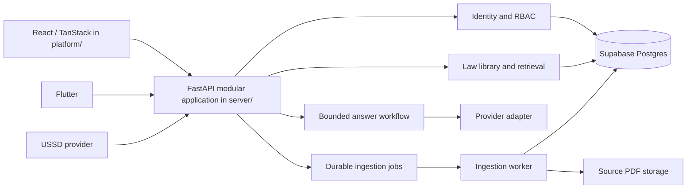

# V2 system architecture

## Baseline and target

The current product is the Next.js modular monolith in `web/`; Flutter is a prototype. The approved V2 target is a new React/Vite, TanStack Router/Query frontend in `platform/` and a separate Python/FastAPI backend in `server/`, with Flutter using the same versioned API. Migrate capability by capability while `web/` remains runnable. The V2 projects are under construction; their existence in the worktree is not evidence that they are shipped or deployed.

Keep auth, laws, retrieval, answer flow, provider adapter, ingestion and observability as independently testable modules inside one backend codebase. Run a separate worker process for expensive ingestion; avoid network microservices per module. One explicit legal-answer pipeline is the initial workflow. Add generic graph editing and multiple agents only for a demonstrated use case, after evaluation and authorization controls.

`platform/` contains UI and generated API clients; `server/` owns authentication, authorization, data access, safety, retrieval, orchestration and provider secrets. Flutter never imports web or platform runtime code. Supabase stores legal data and source PDFs; no client receives its service-role key. Legacy `web/` keeps its own dependencies and remains the runnable migration baseline. Module contracts and the target folder layout (`platform/src`, `server/`, `contracts/`) are detailed in [research](RESEARCH.md#target-repository-layout).

## Dependency boundaries

Provider failure leaves the reader, search and urgent path available when their own dependencies work. Embedding/index failure falls back to exact and lexical search. Worker/queue failure delays ingestion without changing published laws. Identity failure prevents protected actions but need not take down public source access. Database or API failure blocks live legal lookup; static urgent guidance may remain available if safely packaged and maintained. Each fallback requires implementation and failure tests; it is not guaranteed by a diagram.

## Decisions and migration

Use FastAPI and Supabase Auth as target starting choices; verify auth/session migration and representative performance. Use one provider adapter and configuration boundary, and preserve the existing `web/lib/space-bunny.ts` model gateway until server cutover. Hosting and queue vendors remain unselected pending measured cost, connectivity and operational comparison. The repository layout is recorded in [the approved decision](../09-DECISIONS-AND-SOURCES.md#approved-v2-repository-layout-2026-10-28); the current `web/` app keeps its existing admin guards until replaced safely. See [plan](PLAN_RESEARCH.md) and [review](ARCHITECTURE_REVIEW.md).
