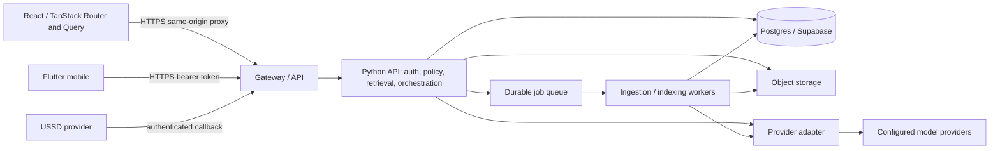
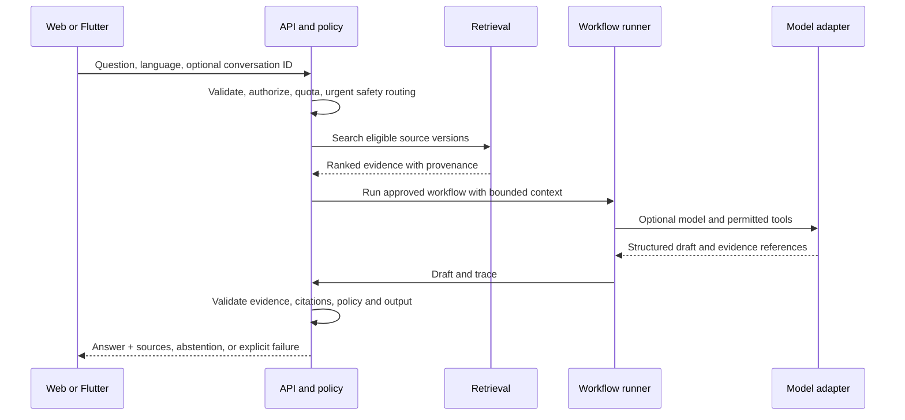
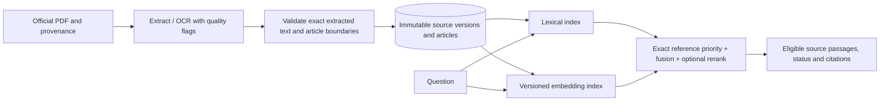
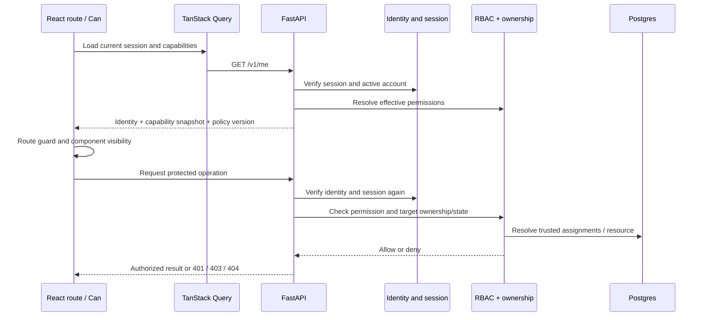
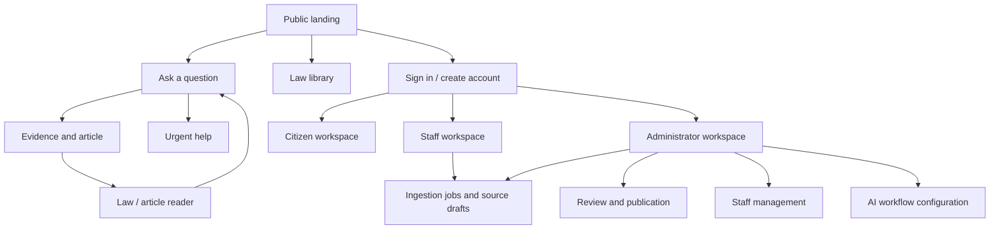

# Rengera AI — architecture research v2

**Research date:** 2026-10-28. **Status:** requested target and research, not a description of deployed infrastructure. The user requests a dedicated server, migration from Next.js to React with TanStack Router and Query, generated OpenAPI clients, configurable agents, scalable RAG, and administrator-managed staff with end-to-end RBAC. Python/FastAPI and Supabase Auth are the documented starting choices; validate implementation details and hosting against real requirements. No live system or corpus was inspected. Source-fidelity and safety rules continue to govern. Read `ARCHITECTURE_REVIEW.md` for the later simplification and failure-isolation critique; it supersedes premature infrastructure commitments in this research.

## People and outcomes

Rengera should help people find and understand Rwandan law, see the exact source and its review/status, recognize uncertainty, and reach urgent help. Design for people in Rwanda, including rural residents, people using shared or low-cost phones, people with disabilities, and Rwandans abroad seeking information about Rwandan law. Validate actual needs with representative users and Rwandan legal reviewers; the repository contains no evidence of a representative user study or an established corpus-completeness target. Support English, Kinyarwanda and French; assess language quality independently, especially Kinyarwanda and mixed-language queries. A question from abroad still uses Rwanda as jurisdiction; any additional jurisdiction requires an explicit product and corpus decision.

The National Institute of Statistics of Rwanda reports that 30% of households had internet access at home in 2023/24, with 56% in urban and 19% in rural areas. These are household access figures, not measures of individual phone access or an estimate of current Rengera users. They support testing low-data and interrupted connectivity, not assuming a single connectivity profile. [NISR EICV7](https://www.statistics.gov.rw/integrated-household-living-conditions-survey-7-eicv-7/eicv7-thematic-report-utilities-and-amenities-202324).

Design implications: usable small screens and keyboard/screen-reader navigation; concise, plain-language explanations with original article text and provenance; optional sign-in for basic questions; inexpensive pages and resumable requests; a deterministic USSD option with its own limits; and clearly dated offline law downloads only after an offline contract is decided. Test accessibility, literacy, terminology, network interruptions, and emergency paths with people in relevant communities. Never promise legal outcomes or claim the corpus is complete.

## Baseline and transformation

The existing `web/` is already React 19 on Next.js 15. It contains UI, server actions, authentication, retrieval, ingestion and model adapter code in a modular monolith. `mobile/` is a Flutter onboarding/login/shell prototype; its login does not establish a reusable native session. The existing corpus is in Supabase/Postgres and Storage, with local migrations 001–016. The deployed database, source inventory, performance, and traffic are unknown. See `docs/02-SYSTEM-ARCHITECTURE.md`, `docs/03-DATA-DESIGN.md` and actual source. The approved target directories are `platform/` (React/Vite) and `server/` (FastAPI); they were absent when the 2026-10-28 baseline inspection began and untracked V2 scaffolding now exists in the worktree. Agent orchestration exists only as a target design.

The target is a new React application in `platform/` using TanStack Router and TanStack Query, served separately from a dedicated API in `server/`. Vite is the suggested browser build tool. Preserve the Flutter client and build both clients against the same versioned API contracts. Migrate capability by capability while the existing Next app in `web/` remains available during transition; the completed frontend no longer depends on Next.js. Existing `web/lib/space-bunny.ts` remains the current model gateway until a documented cutover replaces its responsibility in the server; no duplicate, uncontrolled model access during migration.

## Target system



The queue and workers are proposed components, introduced when ingestion needs durable background execution. They do not imply that every question needs a queue. The API is stateless across replicas; sessions, job state, quotas and idempotency records must not depend on process memory. No model or agent gets direct service-role credentials. Contracts, authorization, source records and operational policies are owned by the API, not the frontend.

### Python or TypeScript

Choose **Python with FastAPI** for the dedicated API and ingestion workers: it fits the existing Python PDF tooling and provides typed request validation and an asynchronous I/O model. Use async database/provider clients for network waits; run OCR and CPU-heavy work in worker processes, not the request event loop. TypeScript remains the frontend language. This choice is an architecture direction, not evidence of higher throughput; validate it against the actual workload. Framework documentation: [FastAPI concurrency](https://fastapi.tiangolo.com/async/) and [deployment workers](https://fastapi.tiangolo.com/deployment/server-workers/).

## Request and agent orchestration



Implement a small workflow runtime behind interfaces: a versioned workflow definition names allowed steps, models, prompts, tool schemas, input/output schemas, budgets, timeout, retry policy, and permitted caller roles. A registry selects only server-approved configurations; users do not supply arbitrary code, endpoints, credentials, or unrestricted tools. Support sequential and bounded parallel steps and optional human approval for privileged actions. Version and audit every change; validate configuration before activation, offer dry-run, canary and rollback, and maintain separate environments. Evaluate whether an established orchestration library is justified by measured workflow complexity; avoid coupling domain contracts to any one framework. “Any configuration” means any configuration expressible within these policies, not unrestricted execution.

Tool calls are proposals from an untrusted model. The server independently checks identity, authorization, input schema and tool allowlist for every invocation. Read tools return scoped data; mutations are separate, explicitly authorized operations with idempotency and audit. Treat retrieved documents and user uploads as untrusted content. Limit iterations, tokens, parallelism, external requests and elapsed time; cancel work on disconnect where appropriate and avoid retries of non-idempotent side effects. Maintain a deterministic safety route and no-evidence abstention even if the model or workflow fails. RAG alone does not prevent prompt injection: [OWASP LLM prompt injection](https://genai.owasp.org/llmrisk/llm01-prompt-injection/) and [OWASP RAG security](https://cheatsheetseries.owasp.org/cheatsheets/RAG_Security_Cheat_Sheet.html).

For streaming, send only progress events until the final answer has passed the required checks; do not stream unverified legal claims as final content. An SSE connection can deliver typed `progress`, `final`, and `error` events, with request IDs, cancellation and reconnect behavior specified in the API. Persist conversation state only under an explicit retention decision; use minimal, redacted telemetry and never log credentials or full legal questions by default.

## RAG and source integrity at scale



Keep original PDF bytes and extracted source text separate from generated metadata. Preserve preamble, article order, language, source URL, hashes, publication/effective dates, status, review state and extraction confidence. Record the extraction method and text normalization; OCR is a derived transcription requiring review, not proof of exact source text. Stage an immutable document version, validate classification and article coverage, then atomically publish its article set and index pointers. Idempotent jobs, retries, dead-letter handling and reconciliation must avoid partial replacement. Review status must describe what was actually reviewed; do not infer legal verification from a classification stamp.

Start with exact law/article reference matching and Postgres full-text search. Add multilingual embeddings and pgvector only after an evaluation demonstrates improved recall and a funded operational plan exists. Hybrid search can combine lexical and semantic candidates with reciprocal rank fusion; see [Supabase hybrid search](https://supabase.com/docs/guides/ai/hybrid-search). Keep embedding model/version/dimensions alongside the index, backfill a new index separately, compare results, and switch atomically with rollback. Semantic search must never suppress an exact reference or be the sole fallback. Filter by jurisdiction, source version and appropriate legal status before ranking; represent unknown status honestly and track amendments and effective dates instead of assuming the newest document settles every question.

Attach immutable source IDs and article anchors to evidence. Validate generated citations against the exact retrieved law **and** article pair, URLs and version; require evidence for substantive claims, and abstain if support is inadequate. A string match alone cannot establish entailment. Use human-reviewed evaluation sets in all three languages, with amendments, repeal, ambiguous questions, missing evidence, OCR errors, urgent cases and adversarial documents. Measure retrieval recall at k, citation resolution and claim support, unsupported-answer and abstention rates, language quality, source freshness and latency; report per language and scenario. Set release thresholds with legal reviewers and product owners before rollout. Store evaluation examples only with consent and a defined retention policy.

## Concurrency and reliability

Measure before selecting capacity: record traffic mix, prompt/context size, p50/p95/p99 end-to-end and retrieval latency, tokens, provider limits, DB connections, queue age, error and abstention rates. Derive a load profile for burst, steady and outage conditions; no throughput target is evidenced yet. Run load tests against controlled, non-production data and approved provider budgets. Use admission control and separate concurrency pools for interactive chat, indexing/OCR and admin tasks. Bound provider concurrency per tenant/instance and globally, enforce distributed rate limits and quotas, use connection pooling with a total connection budget across replicas, and apply backpressure with retry-after responses. Queue only durable work; cap retries with jitter, deadlines and dead-letter review. Provider failures should fail over only to an explicitly configured, evaluated provider and never bypass grounding.

Autoscale stateless API replicas on measured request concurrency/latency and workers on queue age, respecting database and provider limits. Configure health/readiness checks, graceful shutdown, cancellation, request IDs, tracing, metrics and alerts without sensitive payloads. Cache public immutable article versions and static assets with versioned keys; do not share private responses across users. Test DB/provider/queue outage, retry storms, failover, restoration and regional connectivity. Capacity, recovery objectives and spend limits remain owner decisions.

## Authentication, authorization and CORS

Choose Supabase Auth as the shared identity provider because Supabase is already present and supports web and Flutter clients. It is not a drop-in replacement for existing `app_users` and HMAC cookies. Use a controlled account mapping and verified recovery/re-authentication path, preserve ownership, prevent duplicate identities, and revoke legacy sessions only after a staged migration and rollback plan. Do not copy password hashes into a different system without verifying supported import and security requirements.

For browser sessions prefer a same-origin frontend proxy/BFF with secure, HTTP-only, SameSite cookies, CSRF protection and origin validation on unsafe requests. For Flutter use an OAuth authorization-code flow with PKCE and an external browser for OAuth-based sign-in, platform secure storage for refresh material, short-lived access tokens, refresh rotation/revocation, logout and expiry handling. Password login, if retained, must use a supported secure provider flow; PKCE specifically applies to authorization-code flows. [RFC 8252](https://datatracker.ietf.org/doc/html/rfc8252) and [Supabase PKCE](https://supabase.com/docs/guides/auth/sessions/pkce-flow). Validate issuer, audience, signature, expiry and applicable session/account status at the API; plan for key rotation and revocation latency. Do not trust a client-supplied user ID or role. Admin actions require independently verified role and recent stronger authentication; consider MFA. Scope every private operation to the verified owner, including interest profiles and analytics. RLS is defense in depth; service-role access bypasses it. [Supabase RLS](https://supabase.com/docs/guides/database/postgres/row-level-security).

Prefer same-origin browser requests to avoid unnecessary CORS. If cross-origin is needed, configure an exact per-environment origin allowlist, explicit methods and headers, preflight handling, `Vary: Origin`, and credentials only where required; never combine credentialed requests with wildcard origins. CORS is a browser policy, not authentication or a CSRF defense; native apps and other clients are not constrained by it. Verify CSRF protections, disallowed origins and proxy headers in staging. [OWASP HTML5 security](https://cheatsheetseries.owasp.org/cheatsheets/HTML5_Security_Cheat_Sheet.html).

USSD callbacks require provider-specific authentication and replay protection where supported, independent rate limits, short timeouts and minimal phone-number retention. Confirm the chosen provider's actual signature mechanism before implementing; do not assume an origin header authenticates it.

## Deployment and operations

Deploy frontend, API and workers as independently versioned artifacts, with a managed Postgres/Storage backend, a durable queue and a secret manager. Use separate development, staging and production projects; TLS throughout; private network paths where supported; least-privilege credentials; audited admin access; and backups with tested restore. Choose the hosting region from measured Rwanda and diaspora latency, vendor availability, costs and data-residency requirements. The provider choices are recorded below and require staging validation. The React build is served as static assets behind a gateway with SPA history fallback. Provide indexable public pages, metadata and social sharing through the prerendering and server-rendering strategy below; a static SPA alone does not reproduce Next's existing share metadata. Use CI for type/static checks, contract tests, security checks and immutable builds; run expand/contract migrations in staging before release. Keep secrets out of images and client bundles.

Release through staged traffic and feature flags, with health, error, latency, cost, retrieval and citation dashboards; use tested rollback to the old web path. Database migrations and corpus/index versions need independent rollback and restore plans. Production deployment, hosted schema changes, corpus uploads, spend and external contact require applicable authorization. Privacy/retention, breach response, legal review, source licensing, accessibility and operational owners remain open; no compliance conclusion is made here. See `PLAN_RESEARCH.md` for implementation gates.

## Chosen target stack and decisions

These are the implementation defaults selected in response to the user's request. They are target decisions, not claims that the components exist or have been deployed. Pin exact compatible versions when implementation starts and record them in each subproject's lockfile.

| Area | Choice | Reason and boundary |
| --- | --- | --- |
| Web | React, TypeScript, Vite, TanStack Router and TanStack Query | Replace Next.js; preserve brand, accessibility and existing functionality. |
| Server | Python, FastAPI, Pydantic, async HTTP and PostgreSQL clients | OpenAPI-first API and existing Python extraction experience. |
| Identity | Supabase Auth | Shared identity for browser and Flutter; application authorization stays on the API. |
| Browser session | API-owned server session with secure HTTP-only cookie, CSRF token and same-origin reverse proxy | The React SPA never receives a refresh token; the API holds encrypted refresh material server-side. |
| Mobile session | Supabase Auth native client, secure platform storage and bearer access token to API | Device-specific session and refresh; never put a service key in Flutter. |
| RBAC | Server-owned permissions, role assignments and object-level policy | UI visibility mirrors a server capability snapshot; server checks every request. |
| API clients | FastAPI OpenAPI 3.1 → Hey API TypeScript SDK and TanStack Query options; OpenAPI Generator Dart client | Generate from a pinned checked-in spec in CI. Validate Dart generator support against the chosen OpenAPI constructs. |
| Corpus | Supabase Postgres and Storage; PostgreSQL full-text first, pgvector hybrid in a measured later stage | Source versions and legal status are authoritative; vector data is derived. |
| Workflows | Internal typed, versioned workflow runner and tool registry | Framework adapters may be added only when needed; bounded execution and deterministic guards are mandatory. |
| Hosting | Static React hosting with a same-origin API proxy; managed hosting for the API and worker; Supabase Postgres/Storage | Prefer the fewest vendors that meet requirements. Compare available services, cost and latency before choosing; Cloudflare/Cloud Run are examples, not commitments. [Cloud Run concurrency](https://docs.cloud.google.com/run/docs/about-concurrency), [timeouts](https://docs.cloud.google.com/run/docs/configuring/request-timeout), [Pages SPA behavior](https://developers.cloudflare.com/pages/configuration/serving-pages/). |
| Durable work | Durable queue with authenticated worker delivery and idempotent PostgreSQL job records | Select a queue after assessing actual operational needs; at-least-once delivery must not duplicate effects. |

Use available hosting and Supabase regions with the lowest measured latency for Rwanda and the diaspora subject to the owner's data-location requirements. Choose region and actual capacity only after vendor availability and measurements; pretending to know an account's region, budget, traffic or legal requirements would make this design less reliable. Static public pages are prerendered at build time; public consultation share pages and their per-token social metadata are rendered by a dedicated server endpoint without Next.js. Never put private consultation contents in static output or a shared CDN cache.

The user's request supersedes the older Next-only and admin-only architecture direction for the target design. The approved layout, staff permission model and server authorization invariant are recorded in `AGENTS.md`, `docs/02-SYSTEM-ARCHITECTURE.md`, `docs/06-SECURITY-OPERATIONS.md`, `docs/09-DECISIONS-AND-SOURCES.md` and `TASKS.md`, with the detailed policy in [API, auth and RBAC](05-API-AUTH-AND-RBAC.md). The existing code's `getAdminSession()` requirement still applies until a verified replacement exists; this research does not grant staff access in the current app.

## Target repository layout

```text
platform/                    # new V2 frontend (React/Vite); web/ remains the legacy baseline
  src/
    app/                     # providers, router context, query client, bootstrap
    routes/                  # TanStack Router file routes and route guards
    features/
      auth/                  # login, session and account UI
      chat/                  # questions, evidence, feedback and share
      library/               # search, law reader and comparison
      emergency/             # urgent contacts
      admin/                 # dashboard, staff, review, ingestion, settings
    auth/                    # session snapshot, Can, capability hooks
    api/generated/           # generated SDK and query options; never hand-edit
    api/client.ts            # base URL, CSRF, credentials and error handling
    components/              # shared brand and accessible UI
    styles/                  # existing tokens and global styles
  openapi-ts.config.ts
  vite.config.ts
server/
  app/
    main.py                  # app assembly and lifespan
    api/v1/                  # HTTP routers and request/response schemas
    auth/                    # identity, browser session, token verification
    authorization/           # permissions, policies, capability service
    domain/                  # laws, chat, accounts, review and workflows
    repositories/            # scoped database and storage access
    retrieval/               # exact, lexical, fusion, evidence selection
    orchestration/           # runner, registry, state, limits, tool gateway
    providers/               # model, embeddings and storage adapters
    jobs/                    # idempotent ingestion and index job handlers
    safety/                  # deterministic routing, citation and output checks
    observability/           # redaction, tracing, metrics, audit
  tests/                     # contract, authorization and failure tests
  pyproject.toml
mobile/lib/
  core/api/                  # generated Dart client + auth transport adapter
  core/auth/                 # secure session lifecycle
  features/                  # native screens, no imported web runtime
contracts/
  openapi/v1.json            # versioned, reproducible API contract
  README.md                  # generation and compatibility policy
web/supabase/migrations/     # remain the SQL migration owner until moved by decision
```

This layout is a target, not an instruction to move all files at once. Avoid two active copies of a feature after its cutover. The API and frontend own their separate dependency manifests. Database migrations remain in the existing web location during transition to avoid splitting the migration history; move ownership only in a recorded migration decision.

## End-to-end authorization and staff management



Choose three account roles: `user`, `staff`, and `admin`; guests have no account role. Define permissions by action, not by checking role names throughout components. Role assignments are server-controlled and deny by default. A staff member gets only explicit operational permissions: list and inspect source records, submit ingestion, inspect job status and edit draft metadata. Staff do not approve or publish laws, manage accounts, read private citizen data, alter provider configuration or grant roles. Administrators can manage staff, review/publish source material and view administrative metrics. Users access citizen features and their own private records; guests can browse public material and ask questions subject to limits. This is the initial proposed matrix; additions require a reviewed permission change, not an ad hoc UI check. [OWASP authorization guidance](https://cheatsheetseries.owasp.org/cheatsheets/Authorization_Cheat_Sheet.html).

| Capability | Guest | User | Staff | Admin |
| --- | --- | --- | --- | --- |
| Browse public laws and use chat | Allow | Allow | Allow | Allow |
| Own deadlines and shares | Deny | Own | Own | Own where account has an owner identity |
| Read private data of another citizen | Deny | Deny | Deny | Deny by default; a separately approved support procedure is required |
| View ingestion jobs and draft sources | Deny | Deny | Allow | Allow |
| Submit ingestion and edit draft metadata | Deny | Deny | Allow | Allow |
| Approve/review and publish source versions | Deny | Deny | Deny | Allow |
| Invite, suspend or revoke staff | Deny | Deny | Deny | Allow |
| Change admin roles or grant admin | Deny | Deny | Deny | Restricted recovery process; no ordinary staff-management action |
| View aggregated analytics and manage workflows | Deny | Deny | Deny | Allow with relevant permission |

This matrix is an initial policy decision for the target, not a statement of existing access. Public chat requests are computational operations; public database tables remain read-only and anonymous writes are not permitted. If anonymous feedback or telemetry is retained, explicitly decide its collection policy and rate limits instead of letting a service-role server action become an uncontrolled write proxy.

Store `roles`, `permissions`, `role_permissions`, `user_roles`, `staff_invitations` and `authorization_audit` in server-owned tables with foreign keys, unique constraints and timestamps. Identity IDs refer to the chosen identity provider; do not create client-writable role metadata. A permission change and its audit record commit together. Server policies combine the effective permission, active account, verified session, target record ownership and resource state. Avoid a generic admin bypass. Audit actor, target, operation, before/after role, time, request ID and outcome without passwords, tokens or sensitive legal text. Retention and access to audit records need an operational owner.

Admin dashboard flow: an admin creates a time-limited, single-use invitation for the fixed staff role; the recipient completes verified identity setup; the API activates the assignment. An admin can list staff, revoke an unused invite, suspend/reactivate staff and revoke their sessions. Staff cannot change their own role or assign permissions. Admin elevation is excluded from this screen and uses a documented recovery/approval procedure; protect the final active admin from accidental removal. Mutations require a recent strong admin session, are idempotent where appropriate and invalidate target sessions and capability snapshots. The exact invitation channel needs a provider and explicit authorization before contacting recipients.

### React visibility, route guards and cache

`GET /v1/me` returns the verified identity, account status, effective permission names and a `policy_version`; it never returns secrets. A React `AuthProvider` owns loading, anonymous, authenticated and error states. TanStack Router receives that state and the QueryClient through router context. A parent `beforeLoad` checks the resolved session; a nested admin or staff route checks the relevant permission before loading its data. Redirect anonymous users to login with a validated local return path; authenticated but unauthorized users see a 403 page. Treat network failure as unavailable, not authenticated. TanStack Router explicitly states that route guards do not authorize API access: [authenticated routes](https://tanstack.com/router/latest/docs/guide/authenticated-routes).

Provide `Can` for display only, with an explicit permission and optional server-supplied resource capability. While session data is loading or unavailable, hide sensitive controls and show an appropriate loading/error state. A button hidden by `Can` does not protect its handler or API. The route guard must not fetch restricted resources before checking the snapshot, and every API handler independently checks current permissions and target scope. Resource-specific permissions can change after rendering: handle a later 403/404 as a normal result and refresh capabilities.

```tsx
// Illustrative target API; generated permission type comes from the contract.
<Can permission="staff.manage">
  <InviteStaffButton />
</Can>
```

TanStack Query handles server-state caching, not authentication or authorization. Use generated query options in route loaders and components; include account identity and relevant resource/filter parameters in private keys, never tokens. Disable private queries until session resolution. On logout, account switch, suspension, role change or 401, cancel in-flight private requests, remove private cache, reset auth context and invalidate the router; do not reuse data between users. On a 403 refresh the capability snapshot and clear affected data. Prevent late responses from a prior session repopulating the next user's cache. Invalidate affected lists and `/me` after successful role changes. Do not persist private query caches to shared browser storage by default. [Router external data loading](https://tanstack.com/router/latest/docs/guide/external-data-loading) and [Query invalidation](https://tanstack.com/query/latest/docs/framework/react/guides/invalidations-from-mutations).

## OpenAPI, generated clients and route inventory

Every application HTTP endpoint, including auth, admin, public corpus, jobs, webhooks, health and errors, is declared in OpenAPI with unique stable operation IDs, security requirements, request/response schemas and status codes. The schema describes JSON, multipart uploads, `text/plain` USSD responses and streaming media types where applicable. Streaming event semantics, disconnect/reconnect and webhook signature rules need supplemental prose and executable contract checks: code generation does not automatically produce a complete SSE protocol or secure webhook handling.

FastAPI exports OpenAPI 3.1. Pin `@hey-api/openapi-ts` with the SDK, types and `@tanstack/react-query` plugins to generate TypeScript calls and Query options. Flutter uses a pinned OpenAPI Generator Dart client with a handwritten Dio/auth adapter outside generated code. Commit the exported spec and generated clients; CI exports the spec, validates it, regenerates both clients, fails on drift or breaking contract changes, and compiles consumers. Do not hand-edit generated files. Authentication transport, CSRF, error normalization and streaming remain small handwritten adapters. Generated types validate at compile time, not at the server trust boundary. [FastAPI SDK generation](https://fastapi.tiangolo.com/advanced/generate-clients/) and [Hey API](https://heyapi.dev/).

| Endpoint group | Representative operations | Authorization |
| --- | --- | --- |
| `/v1/session` and `/v1/me` | sign-in, refresh, logout, current capabilities | guest for sign-in; verified session for current account |
| `/v1/laws` | list, search, detail, ordered articles, timeline, compare | public read; response shows provenance/status/review |
| `/v1/answers` | create question, progress/final response | guest or user with rate and safety checks |
| `/v1/me/deadlines`, `/v1/me/shares` | list/create/update/delete own records and create share | verified user and owner scope |
| `/v1/shares/{token}` | read unexpired shared consultation | public bearer link, unguessable token and expiry |
| `/v1/admin/ingestions` | submit, inspect job and source draft | `ingestion.create` or `ingestion.read` |
| `/v1/admin/laws/{id}` | edit draft, approve and publish | `law.edit_draft` or `law.publish`, checked separately |
| `/v1/admin/staff` | list, invite, suspend, revoke invitation | `staff.manage` and strong recent admin session |
| `/v1/admin/workflows` and `/v1/admin/analytics` | configure workflows, inspect aggregate metrics | corresponding admin permissions |
| `/v1/integrations/ussd` | provider callback | verified provider mechanism and separate rate limit |

The names above are a contract design for implementation, not existing endpoints. Admin list endpoints must filter results on the server; an ID cannot substitute for authorization. For SSE, send verified final output as a `final` event and document event schemas separately. API errors use a stable envelope with code, safe message, request ID and optional validation details; never expose stack traces or credentials.

## Migration map and deployment details

| Existing location | Target responsibility |
| --- | --- |
| `web/app/page.tsx`, `layout.tsx`, `components/app/AppShell.tsx`, `AppDashboard.tsx` | `platform/src/app/` and typed route/layout files; replace state-only navigation with URLs. |
| `web/components/app/ChatInterface.tsx`, `components/chat/` | `platform/src/features/chat/`; generated answer and feedback clients. Preserve current uncommitted redesign. |
| `web/components/app/LawLibrary.tsx`, `LawComparison.tsx` | `platform/src/features/library/`; generated public law endpoints and deep links. |
| `web/app/actions.ts`, `lib/safety.ts`, `lib/supabase-retrieval.ts` | `server/` answer, safety and retrieval modules; preserve deterministic guards and evaluate parity. |
| `web/app/legal-actions.ts`, `lib/legal-article-parser.ts`, `lib/legal-classification.ts`, `lib/legal-pdf.ts` | `server/` ingestion/review and worker modules; port parsing with multilingual regression fixtures and atomic writes. |
| `web/app/auth-actions.ts`, `lib/auth.ts` | `server/` identity/session bridge and API authorization; staged account migration, no silent cookie cutover. |
| `web/app/product-actions.ts`, `share-actions.ts` | `server/` scoped feature modules; fix user-supplied identity and service-role write gaps. |
| `web/app/api/ussd/route.ts`, `api/mobile/auth/route.ts` | `server/` versioned USSD webhook and mobile identity/client contract; retire broken cookie/token bridge after mobile migration. |
| `web/app/share/[token]/` | `server/` API share endpoint and server-rendered metadata response, plus React share route in `platform/`. |
| `web/lib/space-bunny.ts` | `server/` Python provider adapter only at cutover; retain env-selected model, fallback, timeouts and redacted errors. |
| `mobile/lib/app.dart`, `features/auth/login_screen.dart` | native session provider, secure persistence and generated API transport; extend shell only after auth works. |
| `web/scripts/ingest_legal_pdf.py` and crawler tools | reusable worker extraction library or isolated operational scripts after parity review; no automatic corpus upload. |

Use a same-origin reverse proxy for `/api/*` to the API, carefully forwarding cookies and streaming responses; validate CSRF, origin and trusted proxy configuration in staging. Deploy stateless API instances and a separately authenticated worker with durable job dispatch. Set explicit instance/concurrency caps, request and provider deadlines, DB pool budgets and queue limits, then adjust from load tests. Backend work can continue after a gateway timeout, so handlers must honor deadlines and idempotency. Keep service-role credentials and session encryption keys in server secret management only. Provide exact staging and production origin allowlists and separate project credentials. Provisioning, costs and live migration remain separately authorized actions.

## RAG implementation specification

The following are target contracts for implementation, not existing schema or demonstrated performance. The baseline remains the locally documented Postgres lexical search until the new path is built and tested.

### 1. Source and index data

Keep `laws.raw_content` intact during migration. Add an append-only source-version model through reviewed migrations: a source identifies an instrument; a source version identifies an ingested PDF/extraction; article records carry the version ID, number, order, exact extracted text, citation and page information where available. Store PDF bytes, extraction method, normalization, hashes, OCR provenance, legal status, effective dates, amendment relationships and review state independently of generated fields. Do not equate a classification review with review of legal text, translation, status or legal accuracy.

The source version lifecycle is `received → extracting → staged → validated → reviewed → published`, with explicit `failed` and `superseded` outcomes. Staff can initiate and edit drafts; only an authorized administrator can publish. A staged version cannot be mistaken for a published source. Publish the article set and current-version pointer in one database transaction after all required checks. PDF storage is external to that transaction: track uploads as staged objects and reconcile orphaned objects through an authorized retention process. Retries must use the same idempotency key and never replace published content with incomplete work.

Create search passages as **derived** records linked to article and source-version IDs. Store start/end offsets in the extracted text and validate that a passage matches that span. Long articles may have overlapping passages, but citations always identify the actual article and version. Keep preambles in source and reader output; include them as search evidence only when relevant and label them as preamble.

### 2. Retrieval pipeline

1. Validate question length, language, input format and request quota. Run deterministic emergency routing before search or model work.
2. Normalize a separate search query without changing the user's submitted text or official source. Extract candidate law and article identifiers while retaining original digits and references.
3. Retrieve exact reference candidates and lexical candidates in parallel. Restrict to Rwanda, authorized source versions and applicable publication policy; exclude repealed material for present-law answers unless it is explicitly requested for historical context. Preserve unknown status as unknown.
4. Once evaluated and enabled, retrieve semantic candidates from a versioned multilingual index. Fuse ranks with reciprocal rank fusion; explicitly preserve exact law/article matches. An optional reranker reorders only eligible candidates; it cannot add sources or bypass filters.
5. Deduplicate by source-version/article/passage. Prefer diverse relevant provisions and linked amendments; enforce context size, per-source caps and deadline. Preserve exact evidence IDs and source metadata.
6. Apply evidence-sufficiency rules. A missing exact article, empty extraction, unclear status or absence of a supporting provision must be represented in the response. If retrieval fails, return a service error; if retrieval succeeds but evidence is inadequate, abstain.
7. Construct a bounded evidence package. Treat the legal text and any upload as untrusted data. Never let text within it override system policy, tool permissions or the requested output schema.

### 3. Evidence package and answer checks

Each evidence item contains `source_id`, `source_version_id`, `article_id`, `article_number`, passage offsets, exact extracted text, law reference/title, language, source URL, effective/publication dates, status, review state and retrieval signals. The prompt carries these IDs and asks for structured claims associated with one or more evidence IDs. IDs are assigned by the server; the model cannot create valid new IDs.

Validate the model's schema before rendering. Check each evidence ID against the package, the law/article/version relationship and source URL. Require substantive answer claims to carry a citation reference; reject malformed output or route it through one bounded repair attempt using the same evidence. Claim-to-evidence entailment cannot be established by ID matching: evaluate that separately using reviewer-labelled samples and, where used, an explicitly evaluated automated check. A missing or invalid citation never becomes a verified source badge. Return an abstention if required checks fail.

### 4. Model and index changes

Select a multilingual embedding model only after benchmarking Kinyarwanda, French and English retrieval on a labelled corpus. Version model name, dimensions, normalization, source content hash and chunking version with each vector. Build a separate new index and backfill it without modifying source records. Compare exact/lexical baseline with hybrid on recall at k, exact-reference recall, amendment retrieval, latency, failure and cost by language. Promote with a versioned pointer and preserve rollback. If embedding generation or the index fails, use exact and lexical search; do not silently call an unapproved provider.

### 5. Evaluation and monitoring

Maintain a versioned evaluation set of questions, expected source IDs, acceptable abstentions and reviewer-labelled claim support. Include all supported languages, mixed language, names and number variants, ambiguous facts, conflicting/amended or repealed instruments, unreviewed sources, OCR errors, no-answer questions and urgent cases. Have qualified reviewers set release thresholds and adjudicate difficult examples. Report retrieval recall, citation resolution, supported and unsupported claims, abstention precision/coverage, safety routing and language quality separately; report confidence intervals and sample sizes where possible. Monitor latency, outages, cost, source freshness and aggregate quality without storing sensitive question text by default.

## Agent runtime and configuration specification

### Workflow objects and execution

A workflow definition is immutable once published. It contains an ID, version, input/output schema versions, graph of approved node types, node dependencies, model-profile references, allowed tool names, permissions, budget, deadline, retry/fallback rules and safety/validation requirements. A configuration validator rejects unknown nodes, invalid graph edges, cycles unless a loop has an explicit iteration bound, unknown schemas, inaccessible model profiles and tools outside the allowlist. Workflow state transitions are `draft → validated → evaluated → staged → active → retired`; only an authorized administrator can activate a previously evaluated version. Activation and rollback update an audited version pointer.

The runner creates a request-scoped execution context with request ID, verified principal or guest context, workflow version, deadline, remaining model/tool budget and allowed tools. The model never receives service credentials. The runner records step status, elapsed time, provider/profile version, token/cost counts where available and decision codes, with sensitive content redacted by default. Each step returns a typed result or a typed failure. Parallel steps share a global budget and cancellation token; exceeding the limit fails closed. A failure may follow only the configured bounded retry or fallback branch.

The initial legal-answer graph is: safety → exact/lexical retrieval → evidence sufficiency → structured draft → citation/output checks → final answer or abstention. No model step may bypass safety or use evidence from a different user or jurisdiction. A short article explanation uses the same controls with a smaller context. Classification, translation and reranking use separate workflow definitions and schemas; classification output cannot be persisted unless validation succeeds.

### Tool gateway

Define a registry entry per tool: name/version, input/output schema, side-effect classification, caller permission, resource-scope policy, timeout, concurrency and audit behavior. The gateway validates arguments and rechecks the current principal and target record at invocation time. Search and article tools return only eligible source records; personal-data tools scope queries to the verified owner. Network tools require an explicit host allowlist and egress policy. A model tool request is never an authorization grant.

Mutation tools require a deliberate user or administrator action, server authorization, resource-state validation, an idempotency key and an audit record. Publishing and staff-management tools require an authenticated admin and recent strong authentication. Do not execute an irreversible action because the model requests it. Treat tool results as untrusted data when returned to the model.

### Provider and model profiles

Provider profiles contain provider ID, approved base URL, secret-manager reference, environment, timeout, retry policy and global concurrency cap. Model profiles contain provider reference, environment-selected model ID, task, permitted languages, input/output limits, supported settings, per-call deadline, evaluation version and an explicitly configured fallback. Never store secret values in workflow definitions or generated clients. Validation must reject an unsupported setting or model/task combination before activation.

The API resolves a workflow version and its model profiles at the start of a request and records those versions for the trace. Provider fallback is restricted to retryable failures and another evaluated profile; it cannot omit retrieval or validation. Classification, embedding, translation, answer and reranking have distinct profiles and budgets. Disable a model or workflow quickly through a server-controlled switch; outstanding calls respect deadlines and cancellation. Provider response bodies, tool results and user content must not be logged without an approved retention policy.

### Example workflow definition

This is illustrative and requires a validated implementation schema; the numeric limits are examples, not measured production commitments.

```yaml
id: legal-answer
version: 1
status: draft
input_schema: legal-question-v1
output_schema: legal-answer-v1
steps:
  - { id: safety, type: deterministic_safety_check }
  - { id: retrieve, type: legal_retrieval, depends_on: [safety] }
  - { id: draft, type: model_completion, depends_on: [retrieve], model_profile: legal-answer-primary }
  - { id: validate, type: citation_and_output_validation, depends_on: [draft] }
limits: { max_model_calls: 2, max_tool_calls: 4, timeout_seconds: 45 }
```

## AI API contract and request lifecycle

The initial answer endpoint is synchronous `POST /v1/answers`: it validates the request, runs the workflow within a bounded deadline and returns a final result. Basic anonymous chat need not create a durable conversation. If durable asynchronous answers and SSE are introduced, define a separate job-creation contract, owner/guest capability, expiry, cancellation and reconnect protocol first; do not expose private results through guessable IDs. The existing route inventory above is a target inventory; status/events endpoints are conditional on that asynchronous design.

Illustrative request:

```json
{ "question": "My employer has not paid my overtime. What can I do?", "language": "en", "conversation_id": null }
```

Illustrative final response:

```json
{
  "kind": "answer",
  "language": "en",
  "answer": "The retrieved provisions indicate...",
  "sources": [{ "law_id": "law-id", "source_version_id": "version-id", "article_id": "article-id", "article_number": "43", "status": "unknown", "review_state": "classification_reviewed", "source_url": "https://example.org/source.pdf" }],
  "workflow_version": "legal-answer:1",
  "request_id": "request-id"
}
```

`kind` distinguishes `answer`, `emergency`, `abstention` and `unavailable`; status and review labels must be nullable/unknown when evidence is absent. User identity comes from the verified session, not request JSON. Define 400/401/403/404/409/413/422/429/5xx behavior per operation, an error envelope and safe retry semantics. A request ID is diagnostic, not an authorization token. OpenAPI must describe body, response, security and errors; client generation provides types, not runtime authorization or factual validation.

## Capacity and failure contract

The API uses stateless instances, a shared distributed quota store, bounded async provider calls and a PostgreSQL connection pool with a total budget across replicas. Durable ingestion uses a queue and separately authenticated worker; each job is idempotent, has a deadline, retry limit and dead-letter investigation path. Scale API and workers independently based on observed latency, concurrency and queue age; cap them to protect provider quotas, database connections and spend. A deployment timeout does not necessarily cancel backend work, so propagate a deadline and explicitly cancel where supported.

| Event | Required outcome |
| --- | --- |
| No source matches | Abstention with honest source-search guidance; no unsupported answer. |
| Search service fails | Distinct unavailable response; do not report an empty successful corpus. |
| Semantic index/provider fails | Fall back to exact and lexical search if healthy. |
| Model primary fails | Use an evaluated configured fallback within budget, otherwise unavailable. |
| Citation/schema validation fails | One bounded repair if configured, otherwise abstain; never present the draft as verified. |
| Duplicate job delivery | Return existing job/result; do not repeat publication or side effects. |
| Permission revoked during session | Server denies the next request using current policy; client invalidates capability and private cache. |
| Queue/database outage | Fail or retry within defined limits; leave the last published corpus intact. |

No concurrency or accuracy target is claimed until a representative workload, reviewer-labelled evaluation set, budget and deployment environment exist. Record proposed targets and measured results separately.

## Complete UI and navigation specification

This specifies the target behavior and information architecture, not finished screens. Preserve the user's current uncommitted `WEB-001` work as the starting visual and interaction evidence. Maintain the approved dark canvas `#09090b`, gold `#d8b485`, 3px standard radius, Rengera identity, readable contrast and current three languages. The body font difference between web and Flutter needs a shared decision during implementation; do not silently change the brand. Screens are task-focused and place evidence and urgent help before decoration.



### Routes and page responsibilities

Routes below are target URLs in TanStack Router. Router guards guide navigation; the server still authorizes every operation. A route name is not evidence that its feature exists today.

| Route | Audience and primary task | Essential states and controls |
| --- | --- | --- |
| `/` | Visitor: understand the product and enter chat or library | Accurate scope, three languages, urgent help, clear primary actions; no unsupported statistics or pricing claims. |
| `/login`, `/signup`, `/auth/callback` | Visitor: sign in, register or complete verified auth | Validation, pending, success, expiry and error; accessible password control, safe return URL, no secrets in URLs/logs. |
| `/app/chat` | Guest or signed-in user: ask a question | Language selector, composer, examples, progress, answer, evidence, abstention, unavailable and urgent states; guest use does not require signup. |
| `/app/laws` | Visitor: search and browse indexed material | Search, category filter, result count, loading, empty, no-match and error, with no claim of complete corpus. |
| `/app/laws/$lawId` | Visitor: inspect source and law metadata | Title, reference, status, actual review state, source/PDF, publication/effective dates where known, ordered articles and amendment timeline. |
| `/app/laws/$lawId/articles/$articleId` | Visitor: inspect a cited article | Exact extracted article text, source/version, preamble context where relevant, link back to question and ask-about-article action. |
| `/app/emergency` | Anyone: find urgent help without waiting for AI | Language-aware contact list and prominent immediate action; show uncertain or unavailable contacts honestly. |
| `/app/deadlines`, `/app/settings` | Signed-in citizen: manage own reminders and settings | Owner-scoped CRUD, confirmation for destructive changes, no access to another user's records; session expiry and retry states. |
| `/share/$token` | Link recipient: read an explicitly shared consultation | Valid, expired, revoked and unavailable states; disclose that the bearer link grants access; never cache private content publicly. |
| `/staff`, `/staff/ingestions`, `/staff/ingestions/$id` | Authorized staff: prepare sources and inspect jobs | Upload/paste, provenance, extraction and OCR warnings, validation errors, draft editing, job progress and retry; no publish control. |
| `/admin`, `/admin/review`, `/admin/review/$id` | Authorized admin: assess and publish a source | Original PDF/text beside extracted articles and metadata; review scope, hashes, status, warnings, changes, explicit publish and audit trail. |
| `/admin/staff` | Authorized admin: manage staff accounts | List, invite, revoke invitation, suspend/reactivate, revoke sessions, pending/error/success and audit; no general admin promotion. |
| `/admin/ai`, `/admin/ai/workflows/$id`, `/admin/ai/models` | Authorized admin: configure and inspect AI workflows | Draft/version, allowed steps/tools, profiles, budgets, validation/evaluation, staged activation, rollback and provider health; show secret presence only. |
| `/admin/analytics` | Authorized admin: inspect aggregated service quality | Date range, source/evaluation version, sample size, quality and operational metrics; no unapproved private question disclosure. |
| `/*` | Anyone: recover from missing or unauthorized route | Clear 404 or 403, safe navigation, no disclosure of a protected record. |

Port existing complaints and contract-analysis surfaces only after their purpose, evidence requirements and current API protections are reviewed. Keep any placeholder visibly labelled as unavailable; do not invent a functional feature. Retain USSD as a separate concise Kinyarwanda-first channel with no model in the callback. Flutter uses native navigation for the same citizen concepts and safe states; its current static shell is not feature parity.

### Shared components and behavior

- **Application shell:** responsive navigation, current workspace, account state, language and a visible urgent-help action. Citizen, staff and admin navigation derives from server capabilities; no protected data is preloaded merely because a link is hidden.
- **Question composer:** labelled multiline input, clear send state, supported-language choice and visible limits. Preserve text on a recoverable error. Keyboard submission must not interfere with normal text editing; announce progress and final status to assistive technology.
- **Answer and evidence:** show a concise answer and separate source list with law title, article number, status and classification review state. Each citation opens the exact article/version. Distinguish article text, AI explanation and user-supplied context. A citation match is not presented as legal verification.
- **Source reader:** provide ordered navigation, exact extracted text, source PDF/link, provenance, OCR and extraction indicators when recorded, status and review scope. Unknown, unreviewed and missing fields have explicit labels. Preserve the path back to the answer and show amendment information with dates and uncertainty.
- **Role-aware controls:** `Can` consumes the capability snapshot for visibility; route guards use the same snapshot for navigation. Each server request rechecks the current permission, resource scope and account status. On permission revocation remove protected UI and cached data after server denial or refreshed session.
- **Forms and confirmation:** bind errors to fields, preserve safe input on failure, prevent accidental double submission, show server-side validation, and confirm publication, suspension and other material actions. Announce progress and outcomes without exposing protected data.
- **Tables and lists:** staff, jobs and laws support keyboard-accessible sorting, filtering and pagination where the contract supports them. Clearly label empty, filtered-empty, loading and unavailable states. Mobile layouts must retain actions and labels without horizontal page scrolling.
- **AI administration:** show workflow version, approval/evaluation state, configured model profile, permitted tools, budget and health. Secret values never appear in browser responses. Validation errors must identify the affected field; activation requires the defined authorization and evaluation gate.

### Shared state, accessibility and security

Use TanStack Query for server data, generated API options and consistent keys; use local component state for unsent form input and transient UI. Separate session resolution from an anonymous state; do not redirect a network error to login as though authentication failed. Clear private query cache and cancel pending requests on logout/account switch. Authentication expiry must not discard unsent text without warning. Validate all search parameters and local return paths. The API rejects direct access without authorization regardless of route visibility.

Support keyboard-only operation, visible focus, semantic landmarks and form labels, screen-reader announcements for async states, readable contrast without relying on color alone, zoom/text scaling, reduced motion, touch targets and screen-reader names. Review narrow phone, tablet and desktop; accommodate long Kinyarwanda/French text, long citations, large result sets and low-bandwidth or offline errors. Do not promise offline answers; any cached law must show its version and freshness. Use only supplied or verified user-facing content; have native speakers and qualified reviewers assess language and legal guidance.

## UI implementation and acceptance map

| Area | Existing starting points | Target files and key acceptance |
| --- | --- | --- |
| App shell, public landing and auth | `web/components/app/AppShell.tsx`, `AppDashboard.tsx`, `LoginScreen.tsx`, `web/components/landing/` | `platform/src/app/`, `routes/`, `features/auth/`; real routes, preserved design, session/permission states and direct refresh. |
| Chat and emergency | `web/components/app/ChatInterface.tsx`, `Emergency.tsx`, `web/components/chat/`, `web/lib/answer-language.ts` | `platform/src/features/chat/`, `emergency/`; preserve in-progress work, sources, language and deterministic urgent path. |
| Library and reader | `web/components/app/LawLibrary.tsx`, `LawComparison.tsx` | `platform/src/features/library/`; exact cited article, source and review/status display. |
| Admin and staff | `AdminDashboard.tsx`, `SupabaseLawClassifier.tsx`, `AdminEditLaw.tsx` | `platform/src/features/admin/`; permission-gated drafts, admin review/publication and staff lifecycle. |
| AI controls | Current provider status exists in `web/app/legal-actions.ts` | New workflow/model administration screens using API-managed permissions and secret references. |
| Share, deadlines, settings, alerts | `web/app/share/`, `web/components/chat/DeadlinesPanel.tsx`, `Settings.tsx`, `NotificationsBell.tsx` | Route-based screens and generated clients; ownership, expiry, safe sharing and private cache isolation. |
| Native Flutter | `mobile/lib/features/` and `mobile/lib/app.dart` | Native auth, chat, reader and account journeys; preserve brand semantics, not web runtime imports. |

Acceptance requires real browser/device review for representative viewport sizes and assistive interactions, plus authorization, error and privacy checks. Current task notes record that the user previously asked not to launch the app; obtain applicable permission before a future rendered review if that instruction remains in force. Static documentation cannot establish that a UI is visually or functionally complete.
